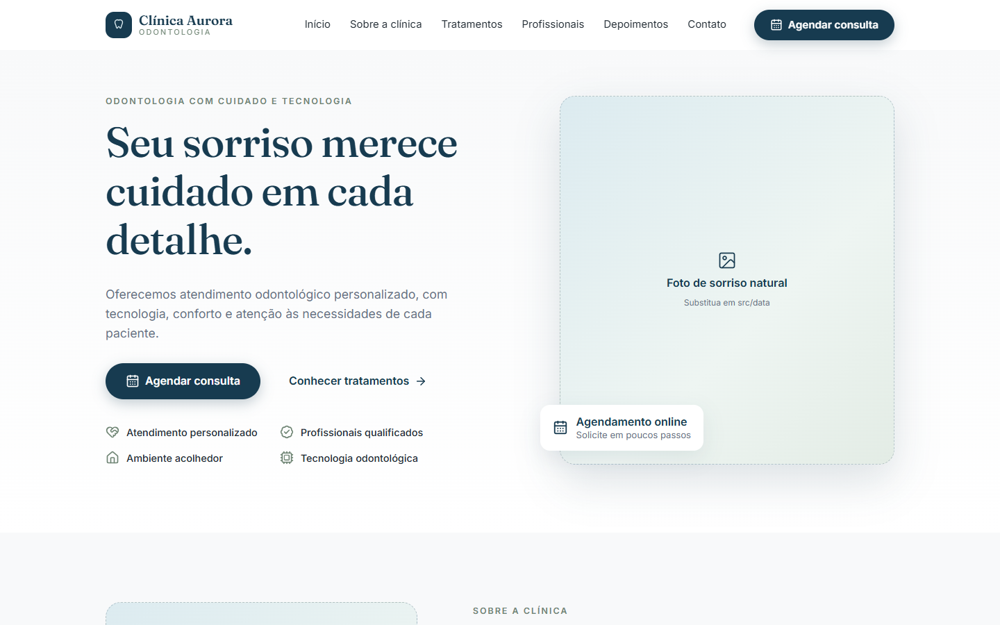
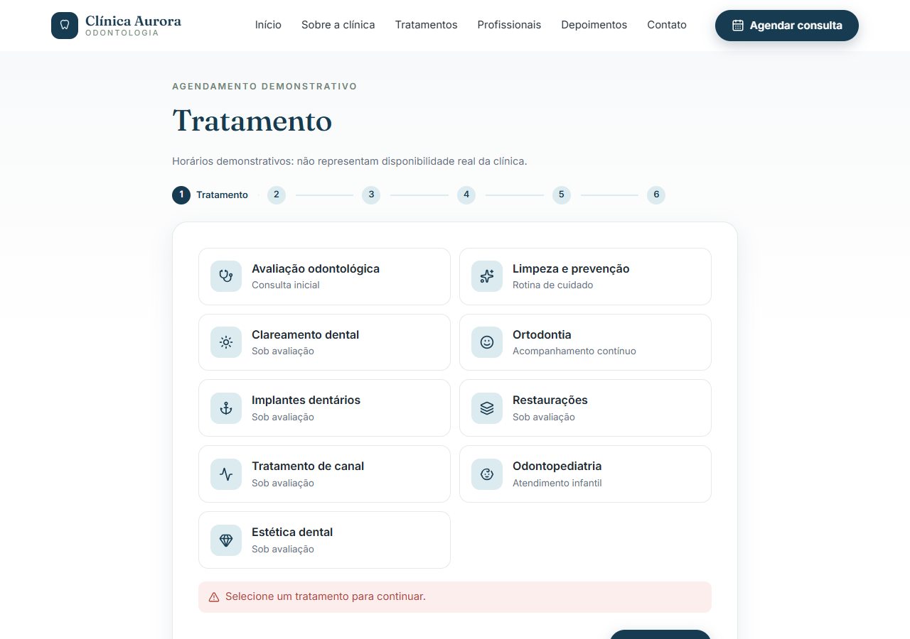
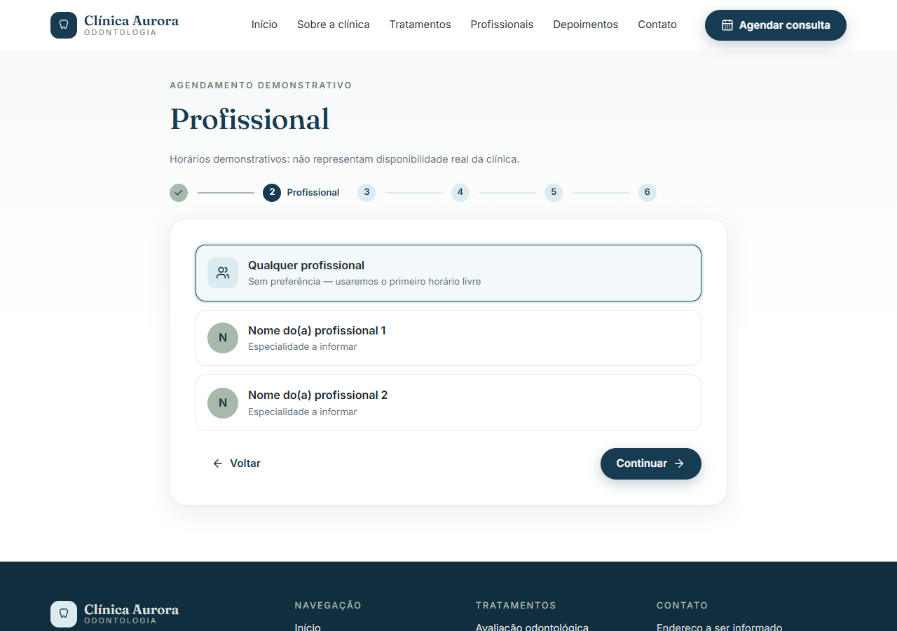
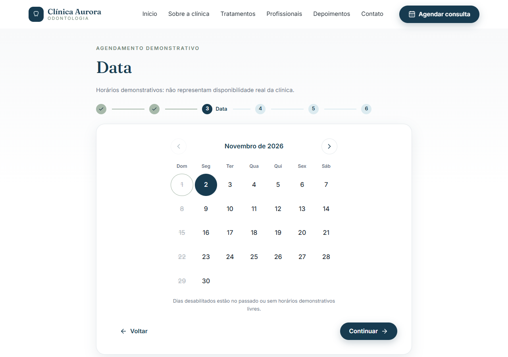
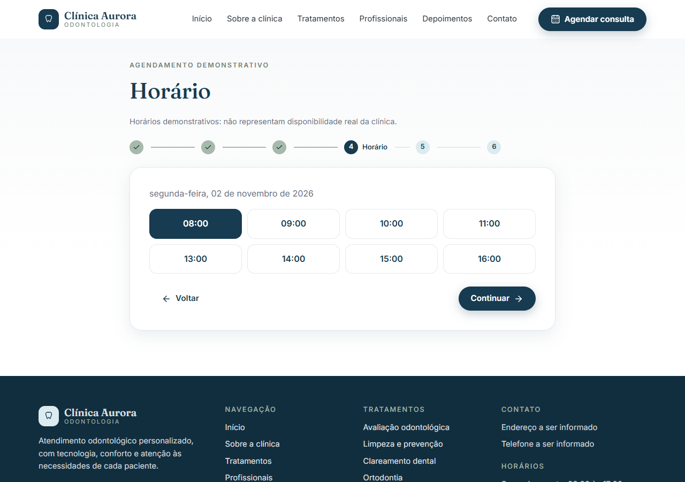
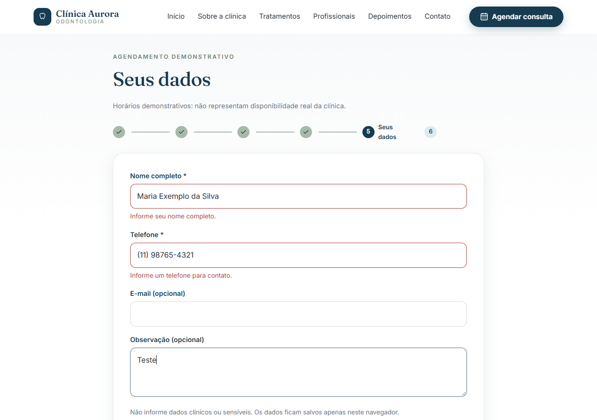
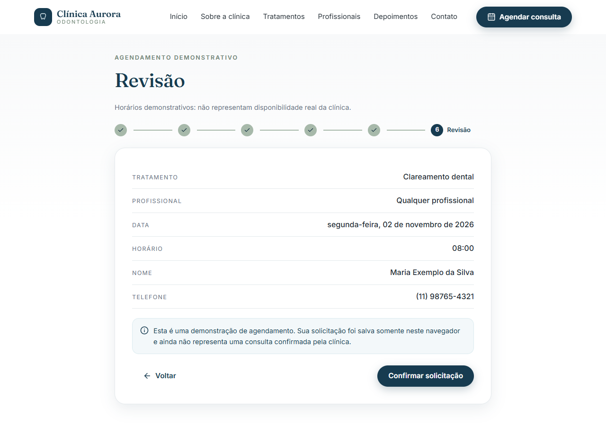
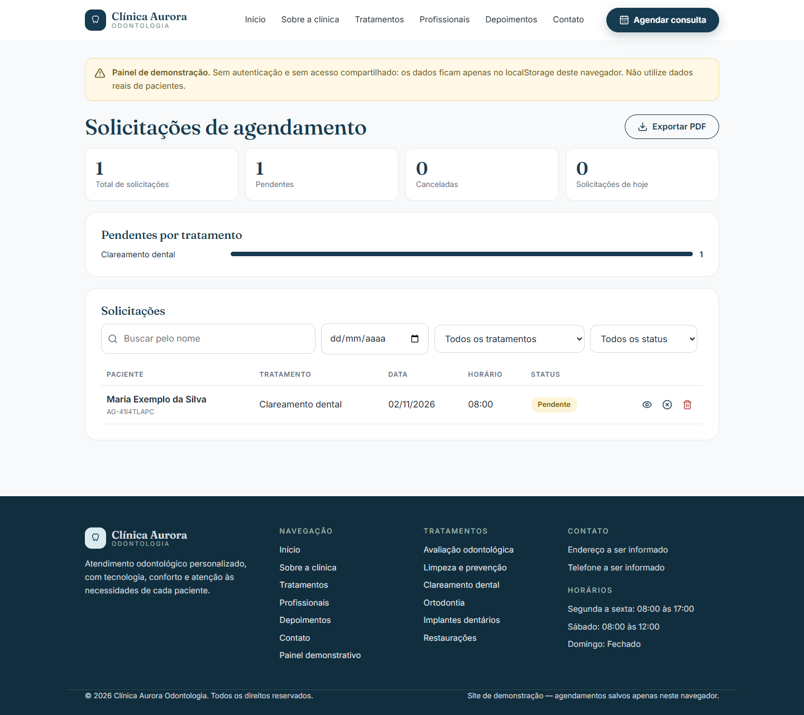

# Clínica Aurora Odontologia — site com agendamento demonstrativo

Site institucional de clínica odontológica (React + Vite, executado com Node.js) com agendamento
online em etapas e painel administrativo **de demonstração**. Não há backend nem banco de dados:
as solicitações ficam no `localStorage` do navegador.

> ⚠️ O `localStorage` **não é um banco seguro** e não é compartilhado entre navegadores/dispositivos.
> Os horários são demonstrativos e não representam disponibilidade real. Não use dados reais de pacientes.

## Capturas de tela

| Início (desktop) | Início (mobile) | Menu mobile |
|---|---|---|
|  |  |  |

**Fluxo de agendamento**

| 1. Tratamento | 2. Profissional | 3. Data |
|---|---|---|
|  |  |  |

| 4. Horário | 5. Dados | 6. Revisão |
|---|---|---|
|  |  |  |

| Confirmação | Painel `/admin` |
|---|---|
|  |  |

Página inicial completa: [docs/home-completa.png](docs/home-completa.png)

> As imagens do site são espaços reservados até que as fotos reais sejam adicionadas.

## PDFs

- **No site:** a tela de confirmação tem o botão **Baixar comprovante (PDF)** e o painel `/admin` tem **Exportar PDF** (usam a impressão do navegador, sem dependências extras).
- **Exemplos prontos** (em `docs/`): [site-completo.pdf](docs/site-completo.pdf), [comprovante-exemplo.pdf](docs/comprovante-exemplo.pdf) e [painel-exemplo.pdf](docs/painel-exemplo.pdf).

## Funcionalidades
- Página inicial com hero, sobre a clínica, tratamentos, profissionais, depoimentos, galeria com visualização ampliada, FAQ em accordion e contato.
- Agendamento em 6 etapas (tratamento → profissional → data → horário → dados → revisão) com validação, calendário interativo, bloqueio de datas passadas e de horários já reservados.
- Confirmação com número de identificação local e opção de cancelar.
- Painel `/admin` demonstrativo: indicadores, gráfico, filtros, busca, detalhes, alterar status e excluir.
- Design responsivo (mobile first), acessível (navegação por teclado, ARIA, foco gerenciado) e com suporte a `prefers-reduced-motion`.
- Conteúdo 100% editável em `src/data/`, sem informações inventadas.

## Tecnologias
React 19 · Vite · React Router · Lucide React · CSS puro · localStorage (somente demonstração)

## Requisitos
- Node.js 18+ (testado com Node 24) e npm

## Instalação e execução local
```bash
npm install
npm run dev        # http://localhost:5173
```

## Build e publicação
```bash
npm run build      # gera a pasta dist/
npm run preview    # testa o build localmente
```
Publique o conteúdo de `dist/` em qualquer hospedagem estática (Netlify, Vercel, GitHub Pages, etc.).
Como o site usa rotas (`/agendar`, `/admin`), configure o fallback para `index.html`
(ex.: Netlify: arquivo `public/_redirects` com `/* /index.html 200`).

## Rotas
| Rota | Descrição |
|------|-----------|
| `/` | Site institucional |
| `/agendar` | Agendamento em 6 etapas (aceita `?tratamento=<id>&profissional=<id>`) |
| `/admin` | Painel demonstrativo (sem autenticação) |

## Editando o conteúdo — `src/data/`
| Arquivo | Conteúdo |
|---------|----------|
| `clinic.js` | Nome, textos, contatos, WhatsApp, redes sociais, horários, seção "Sobre" |
| `treatments.js` | Tratamentos |
| `professionals.js` | Profissionais (nome, CRO, especialidade, dias de atendimento) |
| `schedule.js` | Horários demonstrativos por dia da semana |
| `testimonials.js` | Depoimentos (exemplos marcados como demonstrativos) |
| `gallery.js`, `faq.js` | Galeria e perguntas frequentes |
| `settings.js` | Chave do localStorage e latência simulada |

- **Imagens:** coloque os arquivos em `public/` e informe o caminho (ex.: `'/galeria/recepcao.jpg'`) no campo `src`/`photo`/`image`. Sem imagem, é exibido um espaço reservado.
- **WhatsApp:** preencha `contact.whatsapp` (somente números com DDI, ex.: `5511900000000`) em `clinic.js` para ativar o botão.
- Campos vazios (endereço, telefone, e-mail, redes) aparecem como "a ser informado" — nada é inventado.

## Arquitetura
```
src/
  components/  componentes reutilizáveis (Header, Calendar, Modal, Accordion…)
  sections/    seções da página inicial
  pages/       Home, Booking, Admin
  data/        dados editáveis
  services/    appointmentService.js  ← único ponto de acesso ao localStorage
  hooks/       useAppointments, useReveal, useModal
  utils/       datas, validação, disponibilidade, contato
  styles/      global.css (tokens de design no :root)
```

### Regras do agendamento
- Datas passadas são bloqueadas; dias sem profissional/horário livre ficam desabilitados.
- Um horário é considerado ocupado quando há solicitação **pendente** para o mesmo profissional, data e hora.
  Em "Qualquer profissional", o sistema atribui o primeiro profissional livre.
- Status: `pendente` e `cancelado` (cancelar libera o horário).

## Migrando para Node.js + Express + banco de dados
Toda a interface usa apenas `src/services/appointmentService.js`. Para integrar uma API REST, reimplemente
`list`, `create`, `setStatus` e `remove` com `fetch` (`GET/POST/PATCH/DELETE /api/appointments`), mantendo
o formato dos objetos, e adicione autenticação real ao painel `/admin`. A validação de conflito de horários
deve passar a ser feita no servidor.
